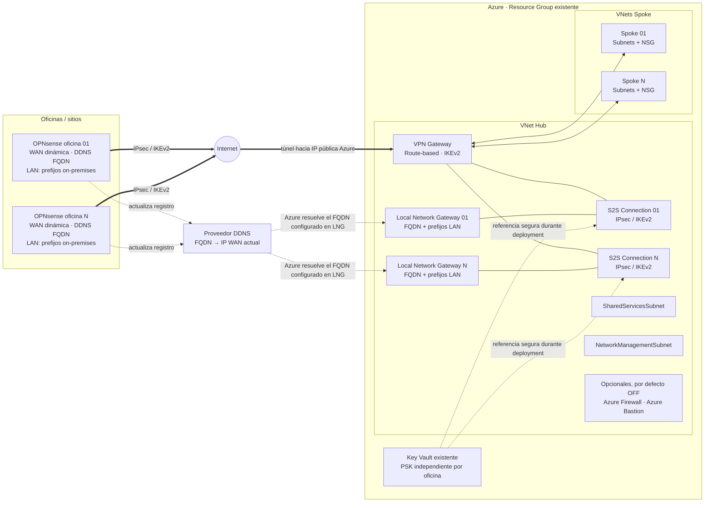
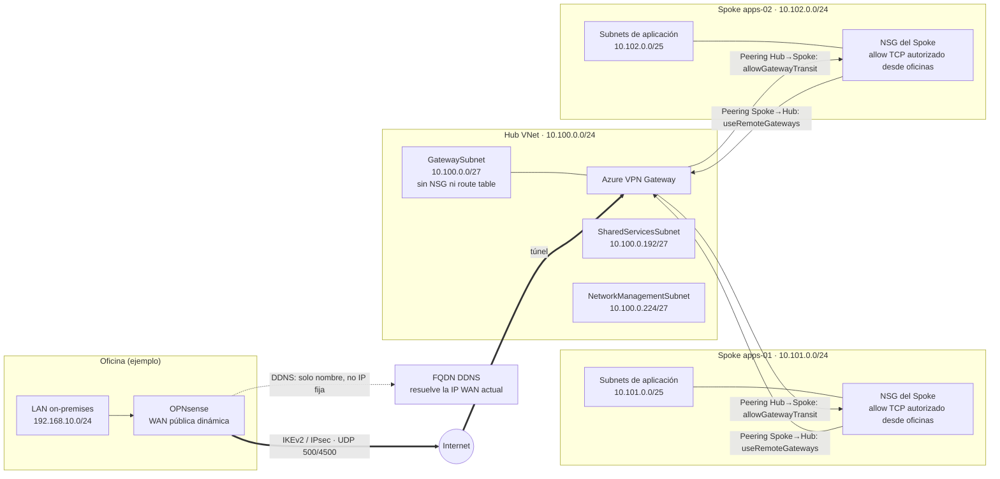

# Conectividad híbrida Azure Hub-Spoke con OPNsense

## 1. Resumen

Esta solución despliega una VNet Hub con Azure VPN Gateway, una o más conexiones Site-to-Site IPsec/IKEv2 a oficinas OPNsense con IPv4 pública dinámica, VNets Spoke, peerings y controles de entrada básicos. Las oficinas dinámicas se configuran en Azure con el FQDN DDNS; el script puede consultar DNS para diagnóstico, pero nunca guarda la IP resuelta en la configuración.

El despliegue es Bicep a nivel de Resource Group y usa modo incremental. El Resource Group debe existir; los scripts no lo crean ni lo eliminan. Los recursos de la solución llevan el tag `Solution=hybrid-vpn-bicep`. El script detiene la operación si detecta una colisión de nombres sin ese tag.

> **Estado:** plantilla de referencia. Los CIDR, región, nombres y endpoints del archivo de ejemplo son ilustrativos; deben reemplazarse y validarse antes de cualquier despliegue.

## Índice

- [Arquitectura y diagramas](#arquitectura-y-diagramas)
- [Supuestos y requisitos](#2-supuestos)
- [Decisiones de arquitectura](#3-decisiones-de-arquitectura)
- [Estructura del repositorio](#4-estructura-del-repositorio)
- [Preparación de parámetros](#5-archivos-de-implementación)
- [Validación local y contra Azure](#6-validación)
- [What-if y despliegue](#7-what-if)
- [DDNS, NAT y cambios de IP](#9-configuración-de-ddns)
- [Configuración IPsec](#10-configuración-ipsec)
- [Pruebas y operación](#11-pruebas)
- [Troubleshooting](#13-troubleshooting)
- [Datos pendientes](#14-datos-pendientes)

## Arquitectura y diagramas

### Vista de infraestructura

El Hub concentra el VPN Gateway y sus conexiones. Cada oficina tiene su propio Local Network Gateway (LNG), conexión IPsec y secreto PSK en Key Vault. Los peerings conectan el Hub con cada Spoke; Firewall, Bastion y Private DNS solo se despliegan según los parámetros opcionales.



### Vista lógica de conectividad y red

Ejemplo con los CIDR ficticios del archivo de parámetros. Sustituirlos por rangos reales sin solapamiento antes de desplegar. La ruta entre oficinas y Spokes atraviesa el VPN Gateway y el peering; el NSG de cada subnet Spoke es el control de entrada declarado por la plantilla.



#### Reglas para interpretar el diagrama

- `GatewaySubnet` hospeda el VPN Gateway y no lleva NSG ni route table.
- `allowGatewayTransit` se activa en el extremo Hub; `useRemoteGateways` se activa en el extremo Spoke.
- Las flechas de peering representan conectividad de red, no una promesa de que cualquier flujo esté permitido por NSG, firewall del host o políticas IPsec.
- El ejemplo no crea conectividad Spoke-to-Spoke ni inserta Azure Firewall en el camino del tráfico.
- El estado de Firewall/Bastion es **apagado** hasta que se habiliten explícitamente; su presencia en la vista de infraestructura es solo una opción.
- Los CIDR del gráfico coinciden con el ejemplo actual y no son una asignación recomendada para todos los entornos.

#### Fuentes editables

- [Diagrama de infraestructura (Excalidraw)](docs/infraestructura.excalidraw)
- [Diagrama de conectividad y red (Excalidraw)](docs/conectividad-red.excalidraw)

## 2. Supuestos

- El Resource Group objetivo y el Key Vault ya existen.
- La cuenta de despliegue tiene permisos para administrar los recursos de red de la solución y leer los secretos de conexión desde Key Vault.
- Cada oficina tiene FQDN DDNS público, prefijos LAN sin solapamientos y un PSK independiente guardado como secreto en Key Vault.
- Los datos de `main.parameters.example.json` son ejemplos no desplegables. No contienen PSK ni token DDNS.
- La configuración de ejemplo usa `mexicocentral`; confirmar la disponibilidad regional del SKU elegido antes de desplegar.
- BGP, Azure Firewall y Azure Bastion están deshabilitados por defecto. No se agregan rutas forzadas ni se habilita tránsito Spoke-to-Spoke.
- Las reglas personalizadas de NSG están vacías en el ejemplo: no se añade una autorización TCP explícita desde las oficinas. Se mantienen las reglas predeterminadas de NSG de Azure; revisar el comportamiento efectivo antes de producción.

## 3. Decisiones de arquitectura

### Red y tránsito

- Las VNets Azure deben usar prefijos RFC1918 que no se superpongan con `192.168.0.0/16`. Las oficinas sí pueden usar, por ejemplo, `192.168.10.0/24`.
- El VPN Gateway vive solo en `GatewaySubnet`. No se asocia un NSG ni una route table a `GatewaySubnet`.
- Solo el peering Hub→Spoke establece `allowGatewayTransit: true`; solo el peering Spoke→Hub establece `useRemoteGateways: true`.
- El tráfico entre dos Spokes no se enruta automáticamente.
- Las reglas de entrada de NSG se crean solo en NSG asociados a subredes Spoke. Las reglas declaradas en `authorizedInboundRules` son TCP y se aplican desde todos los prefijos de oficinas a todos los destinos de las subredes Spoke.
- Cada regla de puerto tiene esta forma: `{"name":"https","destinationPort":443}`. Si no se define ninguna, no hay reglas de entrada personalizadas.

### Oficinas dinámicas y secretos

- Cada Local Network Gateway (LNG) usa `fqdn` y `localNetworkAddressSpace`; no configura simultáneamente `gatewayIpAddress`.
- Las IP DNS observadas son diagnósticas. No se resuelven para después guardar una IP fija en Bicep.
- Cada conexión obtiene su PSK con `keyVault.getSecret(...)`, que se pasa a un parámetro seguro de módulo. No se escriben secretos en archivos, outputs ni mensajes de consola.
- El PSK debe estar ya creado en Key Vault. La solución no crea, rota, muestra ni devuelve secretos.
- Azure VPN Gateway necesita aplicar el PSK a la conexión y administra la configuración operativa de la conexión. El repositorio no puede evitar que el servicio Azure conserve internamente el valor necesario para terminar IPsec; Key Vault es la única fuente persistente controlada por el usuario.
- Cambiar un LNG existente de endpoint IP a FQDN puede requerir recrear las conexiones asociadas. Planificarlo como cambio de mantenimiento.

### Opcionales

- Firewall y Bastion se despliegan solo cuando su parámetro booleano se cambia a `true`. Al habilitar uno, también se incluye su subred reservada en el Hub y se valida que el prefijo sea al menos `/26`.
- Firewall crea una Firewall Policy y una IP pública, pero no instala reglas ni asocia UDR. No inspeccionará tráfico hasta diseñar y desplegar explícitamente las reglas y rutas requeridas.
- Bastion utiliza una IP pública Standard y `AzureBastionSubnet`; no altera `GatewaySubnet`.
- `privateDnsZones` crea cada zona solicitada y la vincula al Hub y a todos los Spokes, sin autoregistro de VM.

## 4. Estructura del repositorio

```text
.
├── docs/
│   ├── conectividad-red.excalidraw
│   └── infraestructura.excalidraw
├── main.bicep
├── main.parameters.example.json
├── modules/
│   └── vpn-connection.bicep
├── scripts/
│   └── vpn.ps1
├── .gitignore
└── README.md
```

## 5. Archivos de implementación

- `main.bicep`: Hub, Spokes, subredes, NSG, peerings, VPN Gateway, LNG, conexiones, DNS privado y recursos opcionales.
- `modules/vpn-connection.bicep`: recurso de conexión IPsec con parámetro seguro para el PSK recuperado desde Key Vault.
- `main.parameters.example.json`: plantilla de configuración con valores ficticios y placeholders.
- `scripts/vpn.ps1`: validación, what-if, despliegue, comprobación DDNS, estado de conexiones y pruebas TCP.
- `docs/*.excalidraw`: fuentes editables de los diagramas de infraestructura y red. Los diagramas Mermaid anteriores son las vistas rápidas para GitHub.
- `.gitignore`: excluye los parámetros locales y los artefactos de compilación.

Copiar el ejemplo a `main.parameters.json` y reemplazar los datos pendientes. El archivo local está ignorado por Git. No añadir PSK, API token ni contraseñas a ese archivo.

### Parámetros de red de ejemplo

| Segmento | CIDR de ejemplo | Uso |
|---|---:|---|
| Hub | `10.100.0.0/24` | Red central |
| `GatewaySubnet` | `10.100.0.0/27` | VPN Gateway |
| `AzureBastionSubnet` | `10.100.0.64/26` | Reservada si Bastion se habilita |
| `AzureFirewallSubnet` | `10.100.0.128/26` | Reservada si Firewall se habilita |
| Shared Services | `10.100.0.192/27` | Servicios compartidos |
| Network Management | `10.100.0.224/27` | Administración de red |
| Spoke `apps-01` | `10.101.0.0/24` | Aplicaciones |
| Spoke `apps-02` | `10.102.0.0/24` | Aplicaciones |
| Oficina `office-01` | `192.168.10.0/24` | Prefijo on-premises de muestra |

Los rangos de Bastion y Firewall solo se incorporan a la VNet Hub cuando se habilita el servicio correspondiente. La asignación de ejemplo está dentro del Hub y evita solapamientos.

## 6. Validación

Requisitos locales: Azure CLI con Bicep disponible, PowerShell 7 recomendado, sesión Azure activa para validación remota, Resource Group existente y Key Vault existente.

```powershell
Copy-Item .\main.parameters.example.json .\main.parameters.json
```

Completar los valores y validar:

```powershell
.\scripts\vpn.ps1 -Mode Validate -ResourceGroupName 'NOMBRE-RG' -ParameterFile .\main.parameters.json
```

La validación compila Bicep, comprueba placeholders, CIDR IPv4, solapamientos Azure/on-premises, subredes dentro de VNets, FQDN, campos BGP cuando aplica, estado de Azure, existencia del RG/Key Vault y ownership de recursos con el prefijo elegido. No cambia recursos ni lee el valor del PSK.

`-LocalOnly` valida estructura, CIDR, nombres, placeholders y compila Bicep, pero **no** comprueba login, suscripción, existencia del Resource Group ni permisos/secretos de Key Vault.

Para validar localmente sin consultar Azure:

```powershell
.\scripts\vpn.ps1 -Mode Validate -LocalOnly -ParameterFile .\main.parameters.json
```

Para oficinas, `addressPrefixes` debe contener al menos un prefijo. El FQDN debe ser un nombre DNS válido. Cada oficina requiere `pskSecretName`. Al habilitar BGP, cada oficina necesita `asn` y `bgpPeerIp`.

Al habilitar BGP, definir además `azureBgpAsn`. Azure asigna la dirección de peer del gateway; consultarla después del despliegue con `az network vnet-gateway list-bgp-peer-status --resource-group NOMBRE-RG --name PREFIJO-vpn-gateway`.

## 7. What-if

```powershell
.\scripts\vpn.ps1 -Mode WhatIf -ResourceGroupName 'NOMBRE-RG' -ParameterFile .\main.parameters.json
```

Revisar el resultado completo antes del despliegue. El script detiene la operación si el what-if incluye un borrado o un tipo de cambio no reconocido. El modo incremental no elimina recursos que se quiten posteriormente de los arrays; retirarlos requiere un procedimiento explícito y revisión manual. No aprobar cambios fuera del prefijo/tags de esta solución.

El what-if es una estimación del plano de control: confirmar en el resultado nombres, regiones, CIDR, peerings, reglas y recursos opcionales. No sustituye la aprobación del cambio ni la prueba de compatibilidad IPsec/OPNsense.

## 8. Despliegue

```powershell
.\scripts\vpn.ps1 -Mode Deploy -ResourceGroupName 'NOMBRE-RG' -ParameterFile .\main.parameters.json -DeploymentName 'hybrid-vpn'
```

El script vuelve a validar, muestra el what-if, exige escribir `DEPLOY` y ejecuta `az deployment group create --mode Incremental`. No hay operación de crear o borrar Resource Group ni un modo Complete.

Usar el mínimo privilegio. La identidad que ejecute el despliegue necesita permisos de escritura para los recursos declarados y permiso de lectura/deployment de secretos de Key Vault. Los nombres de secretos deben existir antes de crear las conexiones.

### Secuencia recomendada

1. Completar los parámetros locales y confirmar que no contienen valores secretos.
2. Ejecutar `Validate`; corregir todos los errores.
3. Revisar permisos de despliegue, disponibilidad regional/SKU, cuotas y secretos existentes en Key Vault.
4. Ejecutar `WhatIf` y revisar cada cambio.
5. Acordar una ventana de cambio; crear/desplegar el Hub y el túnel puede causar interrupciones.
6. Ejecutar `Deploy`, revisar el resultado y verificar gateway, peerings, conexiones y estado del túnel.
7. Configurar OPNsense y confirmar tráfico con pruebas autorizadas.

## 9. Configuración de DDNS

En OPNsense, instalar/configurar `os-ddclient` o el backend recomendado por el proveedor:

1. Crear un hostname DDNS por oficina.
2. Usar el token API de mínimo privilegio; limitarlo a actualizar el registro necesario.
3. Configurar detección IPv4 por WAN y actualización segura/SSL cuando el proveedor lo soporte.
4. Mantener el token solo en la configuración protegida de OPNsense/proveedor. No incluirlo en Git, parámetros, capturas, tickets o logs.
5. Comprobar el FQDN desde una red externa:

```powershell
.\scripts\vpn.ps1 -Mode CheckDns -ParameterFile .\main.parameters.json
```

El modo CheckDns muestra la respuesta A actual para diagnóstico, pero no escribe esa dirección en archivos ni la usa como configuración de Azure.

### CGNAT y Double NAT

Una IP dinámica pública suele funcionar. CGNAT puede impedir que Azure alcance el firewall: comparar la IPv4 WAN de OPNsense con la dirección observada desde Internet. `100.64.0.0/10` es un rango habitual de CGNAT; también investigar si la WAN pertenece a `10.0.0.0/8`, `172.16.0.0/12` o `192.168.0.0/16`.

Double NAT ocurre cuando el módem/router del ISP y OPNsense traducen tráfico. Revisar bridge mode/IP passthrough, reglas de reenvío necesarias, NAT-T y que UDP 500/4500 lleguen al firewall. Si existe CGNAT del proveedor, un port forward local no lo resuelve: solicitar salida de CGNAT o una IPv4 pública.

### TTL y cambio de IP

Configurar un TTL bajo que el proveedor DDNS realmente soporte, por ejemplo 60–300 segundos, y considerar sus límites/cachés. El TTL no elimina cachés recursivas ni acelera la actualización del proveedor. Tras un cambio de IP pueden persistir la IP anterior en cachés DNS; durante la convergencia, IKE/IPsec puede desconectarse temporalmente. DPD y rekey ayudan a recuperar, pero la reconexión no es instantánea.

El FQDN se configura en el Local Network Gateway; no usar la salida de `CheckDns` para reemplazarlo por una IP en Bicep o en el archivo de parámetros.

## 10. Configuración IPsec

Crear una PSK aleatoria, de alta entropía e independiente por oficina. Guardarla directamente como secreto de Key Vault con el nombre indicado por `pskSecretName`; nunca pasar el valor por línea de comandos, Bicep, parámetros, variables de entorno compartidas, logs o chat. La plantilla consume el secreto de forma segura al desplegar la conexión.

Configurar OPNsense con los valores que coincidan con `modules/vpn-connection.bicep`:

| Parámetro | Configuración |
|---|---|
| IKE | IKEv2 |
| IKE encryption / integrity | AES-256 / SHA-256 |
| IKE DH | Group 14 |
| ESP encryption / integrity | AES-256 / SHA-256 |
| PFS | Group 14 |
| Mode | Tunnel |
| PSK | El secreto independiente de esa oficina |
| Remote endpoint | IP pública de Azure VPN Gateway |
| Local networks | Prefijos LAN de la oficina |
| Remote networks | Hub y prefijos de todos los Spokes |

Habilitar DPD, revisar NAT-T y confirmar que UDP 500 y UDP 4500 estén permitidos donde corresponda. Las pantallas/campos dependen de la versión de OPNsense. No usar reglas `Any → Any` permanentes; permitir únicamente los flujos requeridos. Excluir el tráfico privado Azure del Outbound NAT de OPNsense para conservar las IP LAN.

La política exacta del gateway y de OPNsense debe comprobarse con la versión/SKU desplegados antes de producción; una modificación de IP, PSK, selectores o política puede reiniciar el túnel.

## 11. Pruebas

Revisar el estado del túnel:

```powershell
.\scripts\vpn.ps1 -Mode Status -ResourceGroupName 'NOMBRE-RG' -ParameterFile .\main.parameters.json
```

Probar destinos TCP definidos por el operador:

```powershell
.\scripts\vpn.ps1 -Mode Test -TestTarget '10.101.0.10:443' -TestTarget '10.102.0.20:22'
```

Hacer pruebas progresivas: resolución DDNS, estado de conexión/IKE, oficina→Hub, oficina→Spoke, Spoke→oficina y finalmente servicio/puerto autorizado. Confirmar rutas efectivas, NSG, reglas IPsec/LAN y Outbound NAT.

Lista de comprobación posterior al despliegue:

- Confirmar que el FQDN devuelve la IPv4 WAN vigente de la oficina.
- Confirmar estado conectado de la conexión VPN y negociación IKE/CHILD SA en ambos extremos.
- Confirmar prefijos LAN del LNG y selectores/remotos configurados en OPNsense.
- Confirmar estado de ambos peerings por Spoke y las flags de tránsito en el lado correcto.
- Probar por separado TCP a cada host/puerto aprobado; una conexión establecida no demuestra por sí sola que todas las rutas y aplicaciones funcionen.
- Confirmar que no se ha asociado accidentalmente un NSG ni una route table a `GatewaySubnet`.

## 12. Operación

- Mantener estables `resourcePrefix`, nombres de oficinas, nombres de Spokes y nombres de subred.
- Agregar oficinas/Spokes declarativamente, ejecutar Validate y WhatIf y revisar cambios antes de Deploy.
- Supervisar estado de la conexión, bytes de entrada/salida, resolución DDNS, cambio de IP, IKE/CHILD SA, DPD, rekey y logs de OPNsense.
- Rotar PSK en ventana controlada: actualizar Key Vault y OPNsense coordinadamente; verificar el túnel y revocar el valor anterior. El cambio puede provocar interrupción.
- Para retirar infraestructura, preparar un procedimiento específico, identificar recursos por Resource ID y confirmar ownership. Nunca borrar el Resource Group como rollback.
- El SKU, región, transferencia, Firewall, Bastion y retención de logs influyen en costo. Consultar Azure Pricing Calculator antes de habilitar servicios opcionales.

## 13. Troubleshooting

| Síntoma | Revisar |
|---|---|
| FQDN no resuelve | DDNS, hostname, token en OPNsense, WAN/IP detection, TTL, propagación y respuesta A externa. |
| FQDN devuelve IP anterior | TTL/caché DNS, actualización del proveedor y tiempo de propagación. No fijar la IP en Bicep. |
| IKE no inicia | endpoint Azure, PSK de la oficina, IKEv2, AES256/SHA256, DH14, UDP 500/4500, NAT-T, CGNAT y Double NAT. |
| IKE sin CHILD SA | prefijos locales/remotos, selectores, ESP, PFS14, lifetime y address space del LNG. |
| Conectado sin tráfico | Reglas IPsec/LAN, NSG, rutas efectivas, Outbound NAT, firewall del host, peering y puertos. |
| Hub funciona, Spoke no | Hub→Spoke `allowGatewayTransit`, Spoke→Hub `useRemoteGateways`, peering conectado, prefijo Spoke y NSG. |
| Túnel cae al cambiar IP | Estado DDNS, caché/TTL, DPD, renegociación IKE/CHILD SA, NAT-T y logs de OPNsense. Se esperan interrupciones temporales. |
| What-if indica una eliminación | Detenerse; confirmar parámetros y estado de Azure. No desplegar hasta explicar el cambio. |
| LNG pasa de IP a FQDN | El cambio puede requerir recrear las conexiones asociadas; planificar y probar en mantenimiento. |

## 14. Datos pendientes

Antes de producción, completar y verificar esta lista por cada oficina y entorno:

- FQDN DDNS real por oficina.
- Prefijos reales por oficina.
- Proveedor DDNS.
- API token DDNS (guardar en OPNsense/proveedor; no mostrarlo ni incluirlo en archivos).
- PSK independiente por oficina (solo Key Vault y OPNsense; no mostrarla).
- Nombre de cada secreto en Key Vault.
- Key Vault existente, suscripción y Resource Group.
- Región Azure definitiva.
- `Environment`.
- `Owner`.
- `CostCenter`.
- Puertos TCP autorizados por oficina/Spoke.
- BGP habilitado o deshabilitado.
- ASN y BGP peer IP de Azure/on-premises.
- Decisión sobre Azure Firewall.
- Decisión sobre Azure Bastion.
- Private DNS zones requeridas.
- Hosts y puertos de prueba.
- Prefijos y nombres definitivos de Hub, subredes y Spokes.
- Ventana de cambio, responsables y método de rollback.
