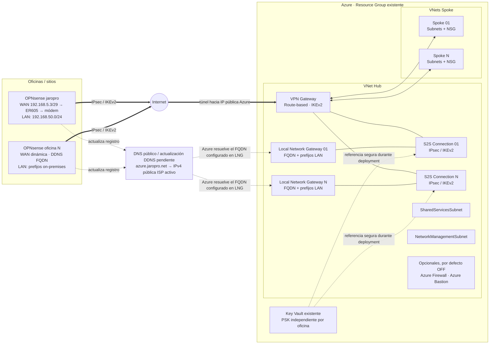
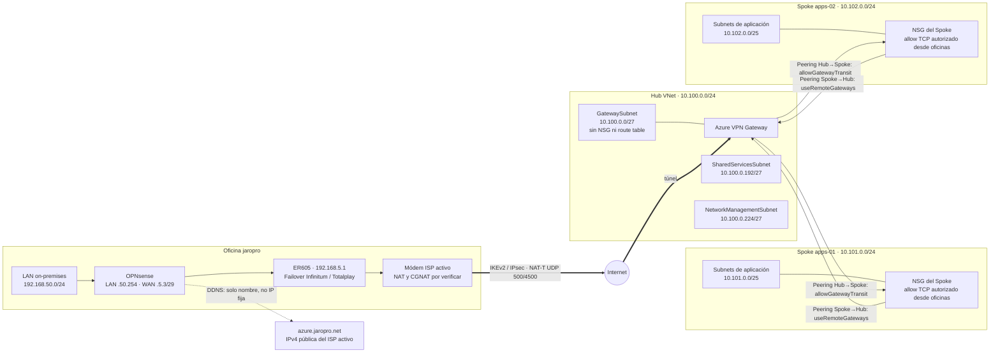

# Conectividad híbrida Azure Hub-Spoke con OPNsense

## 1. Resumen

Esta solución despliega una VNet Hub con Azure VPN Gateway, una o más conexiones Site-to-Site IPsec/IKEv2 a oficinas OPNsense con IPv4 pública dinámica, VNets Spoke, peerings y controles de entrada básicos. Las oficinas dinámicas se configuran en Azure con el FQDN DDNS; el script puede consultar DNS para diagnóstico, pero nunca guarda la IP resuelta en la configuración.

El despliegue es Bicep a nivel de Resource Group y usa modo incremental. El Resource Group debe existir; los scripts no lo crean ni lo eliminan. Los recursos de la solución llevan el tag `Solution=hybrid-vpn-bicep`. El script detiene la operación si detecta una colisión de nombres sin ese tag.

> **Estado:** plantilla de referencia adaptada a jaropro. La LAN confirmada es `192.168.50.0/24` y el FQDN elegido es `azure.jaropro.net`. Persisten placeholders de nombres, etiquetas y Key Vault; no está lista para desplegar. No se ha modificado Azure, DNS ni la LAN.

## Índice

- [Arquitectura y diagramas](#arquitectura-y-diagramas)
- [Supuestos y requisitos](#2-supuestos)
- [Decisiones de arquitectura](#3-decisiones-de-arquitectura)
- [Estructura del repositorio](#4-estructura-del-repositorio)
- [Preparación de parámetros](#5-archivos-de-implementación)
- [Validación local y contra Azure](#6-validación)
- [What-if y despliegue](#7-what-if)
- [DDNS, NAT y cambios de IP](#9-configuración-de-ddns)
- [Configuración IPsec](#10-configuración-ipsec)
- [Pruebas y operación](#11-pruebas)
- [Troubleshooting](#13-troubleshooting)
- [Datos pendientes](#14-datos-pendientes)

## Arquitectura y diagramas

### Vista de infraestructura

El Hub concentra el VPN Gateway y sus conexiones. Cada oficina tiene su propio Local Network Gateway (LNG), conexión IPsec y secreto PSK en Key Vault. Los peerings conectan el Hub con cada Spoke; Firewall, Bastion y Private DNS solo se despliegan según los parámetros opcionales.



### Vista lógica de conectividad y red

La LAN coincide con el mapa jaropro.net v6.6 aportado por el usuario; los CIDR Azure propuestos se conservan porque no se solapan con el inventario revisado. Volver a comprobarlos antes de desplegar. La ruta entre oficina y Spokes atraviesa el VPN Gateway y el peering; el NSG de cada subnet Spoke es el control de entrada declarado por la plantilla.



#### Reglas para interpretar el diagrama

- `GatewaySubnet` hospeda el VPN Gateway y no lleva NSG ni route table.
- `allowGatewayTransit` se activa en el extremo Hub; `useRemoteGateways` se activa en el extremo Spoke.
- Las flechas de peering representan conectividad de red, no una promesa de que cualquier flujo esté permitido por NSG, firewall del host o políticas IPsec.
- El ejemplo no crea conectividad Spoke-to-Spoke ni inserta Azure Firewall en el camino del tráfico.
- El estado de Firewall/Bastion es **apagado** hasta que se habiliten explícitamente; su presencia en la vista de infraestructura es solo una opción.
- Los CIDR del gráfico coinciden con el ejemplo actual y no son una asignación recomendada para todos los entornos.

#### Fuentes editables

- [Diagrama de infraestructura (Excalidraw)](docs/infraestructura.excalidraw)
- [Diagrama de conectividad y red (Excalidraw)](docs/conectividad-red.excalidraw)

## 2. Supuestos

- El Resource Group objetivo y el Key Vault ya existen.
- La cuenta de despliegue tiene permisos para administrar los recursos de red de la solución y leer los secretos de conexión desde Key Vault.
- Cada oficina tiene FQDN DDNS público, prefijos LAN sin solapamientos y un PSK independiente guardado como secreto en Key Vault.
- Los datos de `main.parameters.example.json` son ejemplos no desplegables. No contienen PSK ni token DDNS.
- La configuración de ejemplo usa `mexicocentral`; confirmar la disponibilidad regional del SKU elegido antes de desplegar.
- BGP, Azure Firewall y Azure Bastion están deshabilitados por defecto. No se agregan rutas forzadas ni se habilita tránsito Spoke-to-Spoke.
- Las reglas personalizadas de NSG están vacías en el ejemplo: no se añade una autorización TCP explícita desde las oficinas. Se mantienen las reglas predeterminadas de NSG de Azure; revisar el comportamiento efectivo antes de producción.

## 3. Decisiones de arquitectura

### Red y tránsito

- Las VNets Azure deben usar prefijos RFC1918 que no se superpongan con `192.168.0.0/16`. La oficina jaropro anuncia únicamente `192.168.50.0/24`.
- El VPN Gateway vive solo en `GatewaySubnet`. No se asocia un NSG ni una route table a `GatewaySubnet`.
- Solo el peering Hub→Spoke establece `allowGatewayTransit: true`; solo el peering Spoke→Hub establece `useRemoteGateways: true`.
- El peering Spoke→Hub espera explícitamente al gateway y al peering Hub→Spoke. El ejemplo usa `VpnGw1AZ` con `Generation1`: [la tabla oficial de SKU](https://learn.microsoft.com/azure/vpn-gateway/about-gateway-skus) no admite `Generation2` para ese SKU. Ver también [tránsito de gateway](https://learn.microsoft.com/azure/vpn-gateway/vpn-gateway-peering-gateway-transit).
- El tráfico entre dos Spokes no se enruta automáticamente.
- Las reglas de entrada de NSG se crean solo en NSG asociados a subredes Spoke. Las reglas declaradas en `authorizedInboundRules` son TCP y se aplican desde todos los prefijos de oficinas a todos los destinos de las subredes Spoke.
- Cada regla de puerto tiene esta forma: `{"name":"https","destinationPort":443}`. Si no se define ninguna, no hay reglas de entrada personalizadas.

### Oficinas dinámicas y secretos

- Cada Local Network Gateway (LNG) usa `fqdn` y `localNetworkAddressSpace`; no configura simultáneamente `gatewayIpAddress`.
- Las IP DNS observadas son diagnósticas. No se resuelven para después guardar una IP fija en Bicep.
- Cada conexión obtiene su PSK con `keyVault.getSecret(...)`, que se pasa a un parámetro seguro de módulo. No se escriben secretos en archivos, outputs ni mensajes de consola.
- El PSK debe estar ya creado en Key Vault. La solución no crea, rota, muestra ni devuelve secretos.
- Azure VPN Gateway necesita aplicar el PSK a la conexión y administra la configuración operativa de la conexión. El repositorio no puede evitar que el servicio Azure conserve internamente el valor necesario para terminar IPsec; Key Vault es la única fuente persistente controlada por el usuario.
- Cambiar un LNG existente de endpoint IP a FQDN puede requerir recrear las conexiones asociadas. Planificarlo como cambio de mantenimiento.

### Opcionales

- Firewall y Bastion se despliegan solo cuando su parámetro booleano se cambia a `true`. Al habilitar uno, también se incluye su subred reservada en el Hub y se valida que el prefijo sea al menos `/26`.
- Firewall crea una Firewall Policy y una IP pública, pero no instala reglas ni asocia UDR. No inspeccionará tráfico hasta diseñar y desplegar explícitamente las reglas y rutas requeridas.
- Bastion utiliza una IP pública Standard y `AzureBastionSubnet`; no altera `GatewaySubnet`.
- `privateDnsZones` crea cada zona solicitada y la vincula al Hub y a todos los Spokes, sin autoregistro de VM.

## 4. Estructura del repositorio

```text
.
├── docs/
│   ├── conectividad-red.excalidraw
│   └── infraestructura.excalidraw
├── main.bicep
├── main.parameters.example.json
├── modules/
│   └── vpn-connection.bicep
├── scripts/
│   └── vpn.ps1
├── tests/
│   └── vpn.Tests.ps1
├── .gitignore
└── README.md
```

## 5. Archivos de implementación

- `main.bicep`: Hub, Spokes, subredes, NSG, peerings, VPN Gateway, LNG, conexiones, DNS privado y recursos opcionales.
- `modules/vpn-connection.bicep`: recurso de conexión IPsec con parámetro seguro para el PSK recuperado desde Key Vault.
- `main.parameters.example.json`: LAN y FQDN elegidos, rangos Azure propuestos y placeholders para los datos pendientes.
- `scripts/vpn.ps1`: validación, what-if, despliegue, comprobación DDNS, estado de conexiones y pruebas TCP.
- `docs/*.excalidraw`: fuentes editables de los diagramas de infraestructura y red. Los diagramas Mermaid anteriores son las vistas rápidas para GitHub.
- `.gitignore`: excluye los parámetros locales y los artefactos de compilación.

Copiar el ejemplo a `main.parameters.json` y reemplazar los datos pendientes. El archivo local está ignorado por Git. No añadir PSK, API token ni contraseñas a ese archivo.

### Parámetros de red de ejemplo

| Segmento | CIDR de ejemplo | Uso |
|---|---:|---|
| Hub | `10.100.0.0/24` | Red central |
| `GatewaySubnet` | `10.100.0.0/27` | VPN Gateway |
| `AzureBastionSubnet` | `10.100.0.64/26` | Reservada si Bastion se habilita |
| `AzureFirewallSubnet` | `10.100.0.128/26` | Reservada si Firewall se habilita |
| Shared Services | `10.100.0.192/27` | Servicios compartidos |
| Network Management | `10.100.0.224/27` | Administración de red |
| Spoke `apps-01` | `10.101.0.0/24` | Aplicaciones |
| Spoke `apps-02` | `10.102.0.0/24` | Aplicaciones |
| Oficina `office-01` | `192.168.50.0/24` | LAN real jaropro; único prefijo anunciado |

Los rangos de Bastion y Firewall solo se incorporan a la VNet Hub cuando se habilita el servicio correspondiente. La asignación de ejemplo está dentro del Hub y evita solapamientos.

### Inventario revisado y redes excluidas

Consulta de solo lectura del 22/10/2026 en la suscripción `662141d0-0308-4187-b46b-db1e9466b5ac` (`MCAPS-Hybrid-REQ-116668-2025-rooliva`, tenant `16b3c013-d300-468d-ac64-7eda0820b6d3`): `vnet-superag-eastus` en RG `superag` usa `10.0.0.0/16`; `vnet-finopsazure` en RG `finopsazure` usa `10.30.0.0/16`. Ambas sin peerings. No se encontraron gateways VPN, LNG, hubs o sitios Virtual WAN. No hay solapamiento con los tres `/24` propuestos ni con la LAN de oficina; **no se renumeran ni se conectan esas VNets existentes**.

### Destino confirmado y validación previa al despliegue

El destino confirmado es el Resource Group existente `APPSEROGERVPN`, en `mexicocentral`, suscripción `55318ed6-5d8a-4bd2-889f-10e502960c28` (`MCAPS-Hybrid-REQ-53739-2023-rooliva`), en el mismo tenant. La suscripción del inventario anterior no es el destino del despliegue.

Consulta de solo lectura del 22/10/2026 en el destino:

- Resource Group inicialmente vacío, con estado `Succeeded`; posteriormente el usuario creó allí `keyvaultsecretsvpn`. La identidad actual tiene acciones de administración `*` sin `notActions` en ese ámbito. Esto no demuestra permisos sobre secretos de Key Vault.
- Una VNet existente: `vnet-brujula-central-3936`, RG `ROGERPRIVATEGBB`, con `10.42.0.0/16` y sin peerings. No hay VPN gateways, LNG, hubs ni sitios Virtual WAN. El comprobador de inventario del script no detectó solapamientos con los prefijos de ejemplo.
- Bicep compila. `Microsoft.Network` está registrado y anuncia VPN gateways, VNets e IP públicas en México Central. Las cuotas consultadas de VNets, NSG e IPv4 públicas Standard tienen margen; esto no garantiza capacidad para `VpnGw1AZ`.
- El usuario confirmó que `azure.jaropro.net` es un registro público recién creado y correcto; queda pendiente su propagación o expiración de caché local. El equipo tiene configurados `192.168.50.127` y `192.168.50.1` como servidores DNS IPv4. La consulta explícita a `192.168.50.127` devolvió nombre inexistente; `192.168.50.1`, `1.1.1.1` y `8.8.8.8` devolvieron `189.236.75.52`. La respuesta local distinta no se considera evidencia de un DDNS incorrecto ni motivo para cambiar su configuración. Repetir CheckDns antes de las pruebas desde este equipo; la coincidencia con la WAN no se verificó directamente desde el router. No fijar esta IP en la plantilla. No se modificó DNS.
- El Key Vault previo `kvbrujulacentral3936` en `ROGERPRIVATEGBB` no se seleccionó ni modificó. El usuario creó `keyvaultsecretsvpn` en `APPSEROGERVPN`, región `brazilsouth`, con RBAC, `enabledForTemplateDeployment=true` y acceso público deshabilitado. El vault puede referenciarse desde la VPN en `mexicocentral`; no se cambia su región ni su acceso de red. La identidad CLI no tiene permiso de lectura de metadatos de secretos (`ForbiddenByRbac`); no se leyeron valores de secretos ni se concedieron permisos.
- `main.parameters.json` local, ignorado por Git, usa `roger-vpn`, `Environment=self-learning`, `Owner=rooliva`, `CostCenter=SE ROGEROA`, las redes confirmadas y `keyVaultName=keyvaultsecretsvpn`. Este nombre sustituye la propuesta anterior `kv-roger-vpn-10e50296`.
- El preflight del script pasó. El what-if devolvió `Succeeded`: 13 creaciones de recursos de red, ningún borrado ni modificación y el Key Vault como `Ignore`. Se corrigió el formato de salida del script usando `--no-pretty-print` para procesar JSON.
- **Despliegue bloqueado por el secreto:** la validación ARM con nivel `Provider` devolvió `KeyVaultParameterReferenceSecretRetrieveFailed` / `NotFound` para `vpn-office-01-psk`. El what-if satisfactorio no demuestra que el secreto exista. Crear el secreto con ese nombre en `keyvaultsecretsvpn`, usando la misma PSK que se configurará en OPNsense, o corregir el nombre en los parámetros si ya existe con otro nombre. No guardar el valor en el repositorio ni compartirlo en el chat. Repetir validación ARM, preflight y what-if antes de desplegar. No se desplegaron recursos.

Las redes de módem Infinitum `192.168.4.0/24`, módem Totalplay `192.168.44.0/24` y tránsito ER605 `192.168.5.0/29` son exclusiones, no destinos LAN del túnel. El script rechaza anunciarlas (también prefijos agregados que las incluyan). La reserva Azure fuera de `192.168.0.0/16` evita utilizarlas en Hub/Spokes. No se cambia DHCP ni direccionamiento real.

## 6. Validación

Requisitos locales: Azure CLI con Bicep disponible, PowerShell 7 recomendado, sesión Azure activa para validación remota, Resource Group existente y Key Vault existente.

```powershell
Copy-Item .\main.parameters.example.json .\main.parameters.json
```

Completar los valores y validar:

```powershell
.\scripts\vpn.ps1 -Mode Validate -SubscriptionId '55318ed6-5d8a-4bd2-889f-10e502960c28' -ResourceGroupName 'APPSEROGERVPN' -ParameterFile .\main.parameters.json
```

La validación compila Bicep, comprueba placeholders, CIDR IPv4, solapamientos internos, subredes dentro de VNets, FQDN, campos BGP cuando aplica, estado de Azure, existencia del RG/Key Vault y ownership. `SubscriptionId` es obligatorio para operaciones Azure: cada comando lo pasa explícitamente, sin cambiar tenant ni suscripción predeterminada. No cambia recursos ni lee el valor del PSK.

`Validate`, `WhatIf` y `Deploy` ejecutan el mismo preflight de solo lectura: compara intervalos IPv4 (incluidos solapamientos parciales y contención) contra todas las VNets, prefijos de LNG y pools P2S de gateways de esa suscripción. Recorre peerings y consulta las VNets remotas por ID, incluidas otras suscripciones; fallos de consulta, permisos o respuestas incompletas detienen la operación. Solo exime la coincidencia con el **ID exacto previsto y tag de ownership**, conservando los prefijos existentes. Bloquea cambios del espacio de VNets/LNG propios y renumeración o retirada de sus subredes; un tag o prefijo de nombre por sí solo nunca exime una red ajena. Si el gateway previsto ya tiene P2S, se detiene para no retirar una configuración que esta plantilla no administra.

Si encuentra hubs o sitios Virtual WAN, se detiene para revisión específica de sus pools/rutas. No inventaría redes desconectadas de otras suscripciones, pools P2S de gateways de suscripciones remotas, rutas aprendidas BGP, UDR, traducciones NAT ni redes locales no declaradas. No demuestra disponibilidad de SKU/cuota regional ni reserva direcciones; repetir antes de desplegar y revisar el what-if. Un LNG ajeno que repita la LAN también provoca bloqueo conservador, aunque represente el mismo sitio: requiere revisión, no una excepción automática.

`-LocalOnly` solo se admite con `Validate`: valida estructura, CIDR, nombres, placeholders y compila Bicep, pero **no verifica disponibilidad de redes Azure**, login, suscripción, existencia del Resource Group ni permisos/secretos de Key Vault. Emite una advertencia explícita; no puede usarse para omitir el inventario en WhatIf/Deploy.

Para validar localmente sin consultar Azure:

```powershell
.\scripts\vpn.ps1 -Mode Validate -LocalOnly -ParameterFile .\main.parameters.json
```

Para oficinas, `addressPrefixes` debe contener al menos un prefijo. El FQDN debe ser un nombre DNS válido. Cada oficina requiere `pskSecretName`. Al habilitar BGP, cada oficina necesita `asn` y `bgpPeerIp`.

Al habilitar BGP, definir además `azureBgpAsn`. Azure asigna la dirección de peer del gateway; consultarla después del despliegue con `az network vnet-gateway list-bgp-peer-status --subscription 55318ed6-5d8a-4bd2-889f-10e502960c28 --resource-group APPSEROGERVPN --name PREFIJO-vpn-gateway`.

## 7. What-if

```powershell
.\scripts\vpn.ps1 -Mode WhatIf -SubscriptionId '55318ed6-5d8a-4bd2-889f-10e502960c28' -ResourceGroupName 'APPSEROGERVPN' -ParameterFile .\main.parameters.json
```

Revisar el resultado completo antes del despliegue. El script detiene la operación si el what-if incluye un borrado o un tipo de cambio no reconocido. El modo incremental no elimina recursos que se quiten posteriormente de los arrays; retirarlos requiere un procedimiento explícito y revisión manual. No aprobar cambios fuera del prefijo/tags de esta solución.

El what-if es una estimación del plano de control: confirmar en el resultado nombres, regiones, CIDR, peerings, reglas y recursos opcionales. No sustituye la aprobación del cambio ni la prueba de compatibilidad IPsec/OPNsense.

El script usa `--no-pretty-print --output json`: Azure CLI puede devolver una vista para humanos en what-if aunque se indique solamente `--output json`. Un what-if satisfactorio tampoco garantiza la recuperación del secreto; ejecutar además validación ARM antes de desplegar:

```powershell
az deployment group validate --subscription 55318ed6-5d8a-4bd2-889f-10e502960c28 --resource-group APPSEROGERVPN --name hybrid-vpn-validation --template-file .\main.bicep --parameters '@main.parameters.json' --validation-level Provider
```

## 8. Despliegue

```powershell
.\scripts\vpn.ps1 -Mode Deploy -SubscriptionId '55318ed6-5d8a-4bd2-889f-10e502960c28' -ResourceGroupName 'APPSEROGERVPN' -ParameterFile .\main.parameters.json -DeploymentName 'hybrid-vpn'
```

El script vuelve a validar, muestra el what-if, exige escribir `DEPLOY` y ejecuta `az deployment group create --mode Incremental`. No hay operación de crear o borrar Resource Group ni un modo Complete.

Usar el mínimo privilegio. La identidad que ejecute el despliegue necesita permisos de escritura para los recursos declarados y permiso de lectura/deployment de secretos de Key Vault. Los nombres de secretos deben existir antes de crear las conexiones.

### Secuencia recomendada

1. Completar los parámetros locales y confirmar que no contienen valores secretos.
2. Ejecutar `Validate`; corregir todos los errores.
3. Revisar permisos de despliegue, disponibilidad regional/SKU, cuotas y secretos existentes en Key Vault.
4. Ejecutar `WhatIf` y revisar cada cambio.
5. Acordar una ventana de cambio; crear/desplegar el Hub y el túnel puede causar interrupciones.
6. Ejecutar `Deploy`, revisar el resultado y verificar gateway, peerings, conexiones y estado del túnel.
7. Configurar OPNsense y confirmar tráfico con pruebas autorizadas.

## 9. Configuración de DDNS

En OPNsense, instalar/configurar `os-ddclient` o el backend recomendado por el proveedor:

1. Crear un hostname DDNS por oficina.
2. Usar el token API de mínimo privilegio; limitarlo a actualizar el registro necesario.
3. Detectar la IPv4 **pública de salida del ISP activo**, no la WAN privada `192.168.5.3` de OPNsense; usar actualización segura/SSL cuando el proveedor lo soporte.
4. Mantener el token solo en la configuración protegida de OPNsense/proveedor. No incluirlo en Git, parámetros, capturas, tickets o logs.
5. Comprobar el FQDN desde una red externa:

```powershell
.\scripts\vpn.ps1 -Mode CheckDns -ParameterFile .\main.parameters.json
```

El modo CheckDns muestra la respuesta A actual para diagnóstico, pero no escribe esa dirección en archivos ni la usa como configuración de Azure.

### FQDN elegido: azure.jaropro.net

El usuario controla `jaropro.net` y eligió `azure.jaropro.net` para identificar la salida de la oficina. El coordinador comprobó el 22/10/2026 mediante `Resolve-DnsName -Type A -DnsOnly` contra `1.1.1.1` y `8.8.8.8`: ambos respondieron `A 189.236.75.52`, TTL `3600`. Es evidencia puntual de resolución pública consistente, **no** confirmación de que coincida con la salida actual, de ausencia de proxy/CGNAT, de DDNS automático ni de accesibilidad IPsec. La IP observada no se fija en parámetros ni en el LNG.

Verificar que sea un registro A público **DNS-only, sin proxy/CDN**, apuntando a la IPv4 pública de la oficina, no a la IP pública del gateway Azure. Verificar actualización al cambiar la IP o al conmutar Infinitum/Totalplay. El TTL observado permite caché de hasta una hora; se recomienda 60–300 segundos si el proveedor lo admite, sin afirmar que se haya cambiado. `opnsense.jaropro.net` es el hostname aportado del firewall, no el DDNS seleccionado.

### CGNAT y Double NAT

En jaropro el camino es OPNsense (`192.168.5.3/29`) → ER605 (`192.168.5.1`) → módem del ISP activo. Las WAN del ER605 son `192.168.4.240` vía Infinitum `192.168.4.254`, o `192.168.44.241` vía Totalplay `192.168.44.254`. Hay NAT potencialmente múltiple: la WAN privada de OPNsense por sí sola no demuestra CGNAT. Para cada ISP, comparar la WAN del módem con la IPv4 observada desde Internet; investigar `100.64.0.0/10` y rangos privados.

Double NAT ocurre cuando el módem/router del ISP y OPNsense traducen tráfico. Revisar bridge mode/IP passthrough, reglas de reenvío necesarias, NAT-T y que UDP 500/4500 lleguen al firewall. Si existe CGNAT del proveedor, un port forward local no lo resuelve: solicitar salida de CGNAT o una IPv4 pública.

Verificar IPsec passthrough/NAT-T en ER605 y módem, salida y retorno UDP 500/4500 y, cuando sea necesario, reenvíos encadenados hasta OPNsense sin conflicto con otros terminadores IPsec. No abrir administración del firewall/router a Internet. No se cambiaron esos dispositivos.

### TTL y cambio de IP

Configurar un TTL bajo que el proveedor DDNS realmente soporte, por ejemplo 60–300 segundos, y considerar sus límites/cachés. El TTL no elimina cachés recursivas ni acelera la actualización del proveedor. Tras un cambio de IP pueden persistir la IP anterior en cachés DNS; durante la convergencia, IKE/IPsec puede desconectarse temporalmente. DPD y rekey ayudan a recuperar, pero la reconexión no es instantánea.

El FQDN se configura en el Local Network Gateway; no usar la salida de `CheckDns` para reemplazarlo por una IP en Bicep o en el archivo de parámetros.

El failover del ER605 no equivale a failover VPN instantáneo: actualización DNS, caché, NAT, DPD y renegociación IKE/CHILD SA determinan la reconvergencia. Si falla OPNsense, pasar a Internet por el ROG no conserva este túnel; el ROG tiene WAN independiente (`192.168.5.2/29`) y no es el terminador VPN de esta solución.

## 10. Configuración IPsec

Crear una PSK aleatoria, de alta entropía e independiente por oficina. Guardarla directamente como secreto de Key Vault con el nombre indicado por `pskSecretName`; nunca pasar el valor por línea de comandos, Bicep, parámetros, variables de entorno compartidas, logs o chat. La plantilla consume el secreto de forma segura al desplegar la conexión.

Configurar OPNsense con los valores que coincidan con `modules/vpn-connection.bicep`:

| Parámetro | Configuración |
|---|---|
| IKE | IKEv2 |
| IKE encryption / integrity | AES-256 / SHA-256 |
| IKE DH | Group 14 |
| ESP encryption / integrity | AES-256 / SHA-256 |
| PFS | Group 14 |
| Mode | Tunnel |
| PSK | El secreto independiente de esa oficina |
| Remote endpoint | IP pública de Azure VPN Gateway |
| Local networks | Solo `192.168.50.0/24` en jaropro |
| Remote networks | Hub y prefijos de todos los Spokes |

Habilitar DPD, revisar NAT-T y confirmar que UDP 500 y UDP 4500 estén permitidos donde corresponda. Las pantallas/campos dependen de la versión de OPNsense. No usar reglas `Any → Any` permanentes; permitir únicamente los flujos requeridos. Excluir el tráfico privado Azure del Outbound NAT de OPNsense para conservar las IP LAN.

Aplicar esa exclusión solo a destinos `10.100.0.0/24`, `10.101.0.0/24` y `10.102.0.0/24`; conservar el NAT y la ruta por defecto de Internet. Alinear rutas/selectores IPsec para esos destinos, sin anunciar las redes ISP/tránsito ni introducir `0.0.0.0/0` por el túnel. Elegir y comprobar un modo IPsec coherente con las políticas y rutas de la versión OPNsense instalada antes de producción.

La LAN anuncia actualmente gateway `192.168.50.254` por DHCP del ROG; esto **no garantiza** conmutación automática al ROG `192.168.50.1`. Los DNS primario/secundario tampoco garantizan uso secuencial. No se rediseña LAN/DHCP. Pi-hole `192.168.50.127` puede necesitar forwarding condicional hacia un resolvedor alcanzable en Azure si se requieren zonas privadas; vincular Private DNS a una VNet no basta para resolverlas desde la oficina. No se añade ningún servicio de resolución pagado.

La política exacta del gateway y de OPNsense debe comprobarse con la versión/SKU desplegados antes de producción; una modificación de IP, PSK, selectores o política puede reiniciar el túnel.

## 11. Pruebas

Revisar el estado del túnel:

```powershell
.\scripts\vpn.ps1 -Mode Status -SubscriptionId '662141d0-0308-4187-b46b-db1e9466b5ac' -ResourceGroupName 'NOMBRE-RG' -ParameterFile .\main.parameters.json
```

Probar destinos TCP definidos por el operador:

```powershell
.\scripts\vpn.ps1 -Mode Test -TestTarget '10.101.0.10:443' -TestTarget '10.102.0.20:22'
```

Hacer pruebas progresivas: resolución DDNS, estado de conexión/IKE, oficina→Hub, oficina→Spoke, Spoke→oficina y finalmente servicio/puerto autorizado. Confirmar rutas efectivas, NSG, reglas IPsec/LAN y Outbound NAT.

Lista de comprobación posterior al despliegue:

- Confirmar que el FQDN devuelve la IPv4 WAN vigente de la oficina.
- Confirmar estado conectado de la conexión VPN y negociación IKE/CHILD SA en ambos extremos.
- Confirmar prefijos LAN del LNG y selectores/remotos configurados en OPNsense.
- Confirmar estado de ambos peerings por Spoke y las flags de tránsito en el lado correcto.
- Probar por separado TCP a cada host/puerto aprobado; una conexión establecida no demuestra por sí sola que todas las rutas y aplicaciones funcionen.
- Confirmar que no se ha asociado accidentalmente un NSG ni una route table a `GatewaySubnet`.

Pruebas de regresión locales del script, con inventario simulado y sin acceso Azure ni dispositivos:

```powershell
pwsh -NoProfile -File .\tests\vpn.Tests.ps1
```

## 12. Operación

- Mantener estables `resourcePrefix`, nombres de oficinas, nombres de Spokes y nombres de subred.
- Agregar oficinas/Spokes declarativamente, ejecutar Validate y WhatIf y revisar cambios antes de Deploy.
- Supervisar estado de la conexión, bytes de entrada/salida, resolución DDNS, cambio de IP, IKE/CHILD SA, DPD, rekey y logs de OPNsense.
- Rotar PSK en ventana controlada: actualizar Key Vault y OPNsense coordinadamente; verificar el túnel y revocar el valor anterior. El cambio puede provocar interrupción.
- Para retirar infraestructura, preparar un procedimiento específico, identificar recursos por Resource ID y confirmar ownership. Nunca borrar el Resource Group como rollback.
- El SKU, región, transferencia, Firewall, Bastion y retención de logs influyen en costo. Consultar Azure Pricing Calculator antes de habilitar servicios opcionales.

## 13. Troubleshooting

| Síntoma | Revisar |
|---|---|
| FQDN no resuelve | DDNS, hostname, token en OPNsense, WAN/IP detection, TTL, propagación y respuesta A externa. |
| FQDN devuelve IP anterior | TTL/caché DNS, actualización del proveedor y tiempo de propagación. No fijar la IP en Bicep. |
| IKE no inicia | endpoint Azure, PSK de la oficina, IKEv2, AES256/SHA256, DH14, UDP 500/4500, NAT-T, CGNAT y Double NAT. |
| IKE sin CHILD SA | prefijos locales/remotos, selectores, ESP, PFS14, lifetime y address space del LNG. |
| Conectado sin tráfico | Reglas IPsec/LAN, NSG, rutas efectivas, Outbound NAT, firewall del host, peering y puertos. |
| Hub funciona, Spoke no | Hub→Spoke `allowGatewayTransit`, Spoke→Hub `useRemoteGateways`, peering conectado, prefijo Spoke y NSG. |
| Túnel cae al cambiar IP | Estado DDNS, caché/TTL, DPD, renegociación IKE/CHILD SA, NAT-T y logs de OPNsense. Se esperan interrupciones temporales. |
| What-if indica una eliminación | Detenerse; confirmar parámetros y estado de Azure. No desplegar hasta explicar el cambio. |
| LNG pasa de IP a FQDN | El cambio puede requerir recrear las conexiones asociadas; planificar y probar en mantenimiento. |

## 14. Datos pendientes

Antes de producción, completar y verificar esta lista por cada oficina y entorno:

- Confirmar actualización automática y coincidencia del FQDN elegido `azure.jaropro.net` con la salida pública activa.
- LAN jaropro confirmada: `192.168.50.0/24`; verificar que solo esta se anuncie.
- Proveedor DDNS.
- API token DDNS (guardar en OPNsense/proveedor; no mostrarlo ni incluirlo en archivos).
- PSK independiente por oficina (solo Key Vault y OPNsense; no mostrarla).
- Nombre de cada secreto en Key Vault.
- Key Vault existente, suscripción y Resource Group.
- Región Azure definitiva.
- `Environment`.
- `Owner`.
- `CostCenter`.
- Puertos TCP autorizados por oficina/Spoke.
- BGP habilitado o deshabilitado.
- ASN y BGP peer IP de Azure/on-premises.
- Decisión sobre Azure Firewall.
- Decisión sobre Azure Bastion.
- Private DNS zones requeridas.
- Hosts y puertos de prueba.
- Prefijos y nombres definitivos de Hub, subredes y Spokes.
- Ventana de cambio, responsables y método de rollback.
